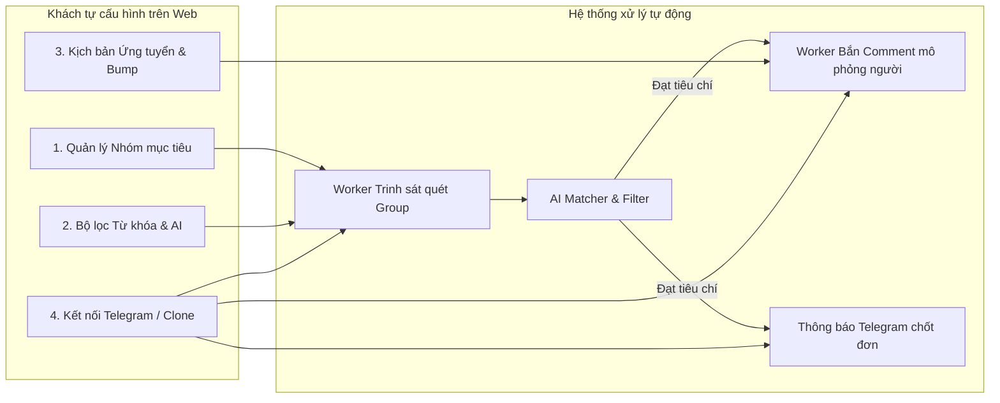

# 🚀 ĐẶC TẢ Ý TƯỞNG & KIẾN TRÚC NỀN TẢNG "COMMHUNTER AI" (F-LEADS)

> **Tầm nhìn:** Nền tảng SaaS tự phục vụ (Self-Service Platform) giúp các cá nhân, creator, shop dịch vụ (như viết truyện commission, vẽ commission, dịch thuật, content marketing...) **tự động hóa 100% quy trình săn tìm khách hàng, ứng tuyển và duy trì tương tác trong hội nhóm Facebook** mà không bị Facebook quét phạt hay dính gậy.

---

## 1. Bối cảnh & Bài toán thực tế

### 1.1 Vấn đề của khách hàng (Từ case study thực tế)
* Khách hàng là chủ dịch vụ nhận viết commission (*Nyatymita's Writing Commission*).
* **Nỗi đau:**
  * Thuê cộng tác viên (CTV) nhưng CTV lười biếng, thiếu trách nhiệm (10 bài mới ứng 1 bài, cả tuần không cmt). Hậu quả: 1–2 tháng không có khách mới.
  * Bản thân bận công việc gia đình, con ốm, không thể túc trực lướt nhóm 24/7.
  * Tự tay vào ứng vài bài là có khách ngay $\rightarrow$ **Cơ hội ra đơn nằm ở tốc độ và tần suất xuất hiện đúng lúc khách có nhu cầu.**
  * Lo sợ dùng Fanpage chính hoặc tài khoản thật đi cmt dạo sẽ bị Facebook "quánh gậy", khóa tính năng hoặc sập Page.

### 1.2 Giải pháp nền tảng mang lại
* **Thay thế hoàn toàn CTV:** Hoạt động liên tục 24/7 với chi phí rẻ hơn nhưng kỷ luật 100%.
* **Có mặt ngay khi nhu cầu phát sinh:** Chỉ mất 1–3 phút từ khi khách đăng bài tìm dịch vụ để bot phát hiện và gửi phản hồi ứng tuyển.
* **Tự do cấu hình (Self-service):** Khách tự định nghĩa từ khóa, group mục tiêu, kịch bản phản hồi, link portfolio trên giao diện Web Dashboard mà không cần biết lập trình.

---

## 2. Các phân hệ chức năng tự cấu hình (Self-Service Features)



### 2.1 Quản lý Chiến dịch & Nhóm mục tiêu (Group Manager)
* Nhập danh sách URL hoặc Group ID Facebook cần quét (hỗ trợ cả nhóm công khai và nhóm riêng tư mà tài khoản clone đã tham gia).
* Đặt tần suất kiểm tra (ví dụ: mỗi 5 phút, 15 phút, 30 phút).
* Hiển thị trạng thái nhóm: Hoạt động, Đang chờ duyệt tham gia, Bị giới hạn.

### 2.2 Bộ lọc Điều kiện thông minh (Rule-based & AI Filtering)
* **Từ khóa bắt buộc (Whitelist):** `tìm comm`, `cần viết`, `nhận viết`, `tìm author`, `budget`, `thể loại`, v.v.
* **Từ khóa loại trừ (Blacklist):** Bỏ qua bài đăng có chữ `tuyển CTV kiếm tiền`, `nhập mã`, `quảng cáo`, `đã tìm được tác giả`...
* **Bộ lọc AI hiểu ngữ cảnh (Prompt-based AI Filter):**
  * Khách chỉ cần gõ yêu cầu bằng tiếng Việt tự nhiên:
    > *"Chỉ lấy các bài tìm người viết truyện chữ, tiểu thuyết, fanfic có đề cập ngân sách > 100k. Bỏ qua bài viết tuyển CTV dịch thuật hoặc viết bài chuẩn SEO."*
  * Mô hình ngôn ngữ sẽ phân tích bài viết và lọc chính xác tới 99%, loại bỏ hoàn toàn các bài rác.

### 2.3 Xưởng kịch bản phản hồi (Comment Studio & AI Responder)
Khách hàng có thể lựa chọn linh hoạt giữa 2 phong cách cmt:
* **Cách 1: Mẫu kịch bản Spin-Tax truyền thống:**
  * `{Chào bạn|Hello cậu|Hi bạn}, mình bên {Nyatymita Writing|dịch vụ viết truyện} nhận thể loại này nhé. {Bạn check ib mình gửi demo nha|Ib mình trao đổi chi tiết nhé!} ✨`
* **Cách 2: AI Tự sinh lời chào cá nhân hóa theo bài đăng (Khuyên dùng):**
  * Bot đọc nội dung bài đăng, tìm các chi tiết đặc thù (ví dụ: khách muốn viết fic đề tài cung đấu) và tự tạo bình luận:
    > *"Bên mình chuyên nhận thể loại cung đấu/cổ trang, từng hoàn thành nhiều bộ cùng đề tài. Bạn ghé qua portfolio mình ghim trên đầu trang cá nhân để xem thử văn phong nhé!"*
  * Bình luận không bị trùng lặp, cực kỳ tự nhiên và đánh trúng tâm lý người thuê.

### 2.4 Hẹn giờ tự động Bump bài (Auto-Bump Scheduler)
* Khách hàng nhập link bài đăng quảng bá dịch vụ của mình trong các nhóm.
* Cấu hình khung giờ "vàng" (ví dụ: 09:00 sáng, 14:00 chiều, 20:30 tối).
* Bot tự động vào bài thả bình luận: `Up bài`, `Vẫn còn slot tháng này nha cả nhà`, hoặc sticker ngẫu nhiên để đẩy bài lên đầu bảng tin nhóm.

### 2.5 Hai chế độ vận hành linh hoạt
1. **Chế độ Bán tự động (Semi-Auto - An toàn tuyệt đối):**
   * Bot quét thấy bài viết phù hợp $\rightarrow$ Bắn tin nhắn qua Telegram cho khách.
   * Trên Telegram đính kèm 3 nút bấm tương tác nhanh:
     * `[Bắn kịch bản A]`
     * `[Bắn kịch bản B (có portfolio)]`
     * `[Bỏ qua bài này]`
   * Khách bấm nút trên điện thoại $\rightarrow$ Bot mới vào cmt đúng kịch bản được duyệt. Khách vừa không mất công lướt tìm bài, vừa kiểm soát 100% nội dung.
2. **Chế độ Tự động hoàn toàn (Full-Auto):**
   * Bot tự động quét, tự lọc và tự comment trong ngưỡng an toàn mà không cần khách can thiệp. Phù hợp khi khách ngủ đêm hoặc bận việc gia đình.

---

## 3. Kinh nghiệm thực chiến từ cộng đồng MMO & Chống Ban (Anti-Ban Playbook)

### 3.1 Mô hình phân tách: "Trinh sát" (Scout) & "Tay súng" (Shooter)
* **Tài khoản Trinh sát (Scout / Reader):** Chỉ lướt group cào bài, không like, không cmt $\rightarrow$ Tài khoản này có độ bền vĩnh cửu, không bao giờ bị Facebook quét gậy.
* **Tài khoản Tay súng (Shooter / Writer):** Chỉ xuất hiện khi có bài cần cmt, cmt xong là rút lui ngay. Nếu tài khoản này lỡ bị khóa tính năng tạm thời (block cmt 24h), hệ thống chỉ cần thay thế một clone khác, quy trình giám sát bài viết không hề bị gián đoạn.

### 3.2 Chiến thuật né "Bẫy Link & Fanpage"
* **Không bao giờ cmt dán link trực tiếp liên tục:** Meta sẽ tự động **Shadowban** (ẩn comment đối với người khác) hoặc đánh dấu Fanpage chính là nguồn spam.
* **Chiến thuật Profile Landing Page:** Ghim bài viết giới thiệu Page/Portfolio lên đầu tường nhà của nick Clone. Trong comment chỉ hướng dẫn: *"Mình ghim sẵn bảng giá và demo ở đầu tường nhà, bạn nghía qua nha"*.
* **Tách biệt hoàn toàn Fanpage chính:** Tuyệt đối không dùng Fanpage chính đi cmt tự động. Fanpage chính chỉ đóng vai trò nhận tin nhắn tư vấn và chốt đơn.

### 3.3 Mô phỏng sinh học người thật (Human Emulation)
* Tái sử dụng module từ `ai-comment-bot-main`:
  * Rê chuột rung lắc ngẫu nhiên (`human_mouse_jiggle`).
  * Gõ phím từng ký tự có độ trễ (`human_type`), có lỗi gõ sai rồi xóa sửa (`BACKSPACE`).
  * Cuộn trang đọc lướt (`random_scroll`).
  * Giãn cách an toàn từ **5 – 15 phút** giữa các lần bình luận.
  * Giới hạn tối đa **15 – 25 bình luận / ngày / 1 tài khoản clone**.

### 3.4 Quy tắc an toàn với Admin Group
* **Blacklist Admin/Mod:** Tự động phát hiện và bỏ qua các bài viết do Ban Quản trị nhóm đăng để tránh bị bấm "Report Spam".
* **Kiểm tra bài cạnh tranh:** Nếu một bài viết đã có trên 5 người nhảy vào ứng tuyển, bot có thể tự động bỏ qua để tránh gây ức chế cho người đăng và giảm nguy cơ bị report.

---

## 4. Kiến trúc công nghệ đề xuất (Tech Stack)

```
┌─────────────────────────────────────────────────────────────┐
│                    WEB DASHBOARD (Frontend)                │
│     Next.js / Tailwind CSS / Shadcn UI / Telegram WebApp   │
└──────────────────────────────┬──────────────────────────────┘
                               │ REST / WebSocket
┌──────────────────────────────▼──────────────────────────────┐
│                    API GATEWAY & BACKEND                    │
│           Python (FastAPI) hoặc Node.js (NestJS)            │
│  - Quản lý tài khoản & gói cước                             │
│  - Lưu trữ cấu hình chiến dịch, từ khóa, kịch bản           │
│  - Dispatcher điều phối Job qua Celery / BullMQ             │
└──────────────────────────────┬──────────────────────────────┘
                               │
            ┌──────────────────┴──────────────────┐
            ▼                                     ▼
┌──────────────────────────────┐    ┌──────────────────────────────┐
│     SCOUT WORKER POOL        │    │     SHOUTER WORKER POOL      │
│ (Kế thừa từ fbn & openclaw)  │    │  (Kế thừa ai-comment-bot)    │
│ - Playwright Persistent      │    │ - Playwright Stealth         │
│ - Residential Proxy          │    │ - Human Typing & Jiggle      │
│ - Chỉ đọc feed & cào post    │    │ - OpenAI GPT-4o-mini engine  │
│ - Lưu deduplication SQLite   │    │ - Thực thi cmt & bump bài    │
└──────────────────────────────┘    └──────────────────────────────┘
```

---

## 5. Mô hình kinh doanh & Đóng gói sản phẩm (Pricing Strategy)

| Gói cước | Chi phí | Quyền lợi & Thông số kỹ thuật | Phù hợp với |
| :--- | :--- | :--- | :--- |
| **Gói Starter** | **199.000đ / tháng** | • Giám sát 5 group<br>• Dùng 1 nick clone tự cấp<br>• Cmt theo kịch bản mẫu Spin-tax<br>• Báo về Telegram cá nhân | Cá nhân mới bắt đầu làm dịch vụ, ngân sách nhỏ |
| **Gói Pro** *(Đề xuất)* | **399.000đ / tháng** | • Giám sát 20 group<br>• Hỗ trợ xoay vòng 2–3 clone<br>• **AI tự sinh bình luận theo ngữ cảnh**<br>• Tự động Bump bài theo giờ<br>• Chế độ Semi-Auto nút bấm Telegram | Các chủ shop như khách Nyatymita (tiết kiệm hơn thuê CTV) |
| **Gói Studio / Agency** | **799.000đ / tháng** | • Giám sát không giới hạn group<br>• Cung cấp sẵn dàn clone chất lượng cao + Proxy sạch<br>• Tích hợp đa kênh, phân quyền nhiều nhân viên | Đội ngũ dịch thuật, studio vẽ, agency content |

---

## 6. Kế hoạch hành động từng bước (Execution Plan)

1. **Bước 1 (Quick Win cho khách Nyatymita):**
   - Viết 1 script kết hợp: Lấy module bóc tách nhóm của `openclaw-skills/facebook-group-monitor` + logic gõ phím của `ai-comment-bot-main` + cấu hình Apprise Telegram của `fbn-main`.
   - Cài đặt cho khách chạy trực tiếp hoặc chạy trên máy chủ hộ khách để thu tiền ngay trong tuần này.
2. **Bước 2 (Xây dựng Web Dashboard Self-service):**
   - Xây dựng giao diện Web cho phép khách tự nhập danh sách group, từ khóa và kịch bản.
3. **Bước 3 (Thương mại hóa & Mở rộng):**
   - Đóng gói thành SaaS, quảng bá đến các cộng đồng Writer, Artist, Designer, Freelancer đang có cùng nhu cầu tìm khách trong group Facebook.
