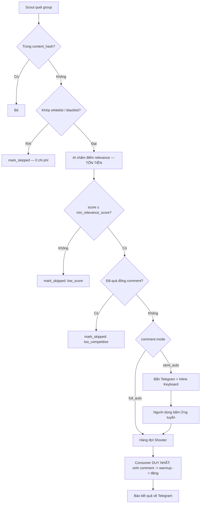
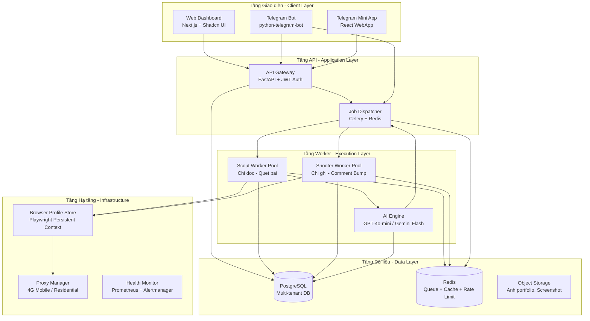
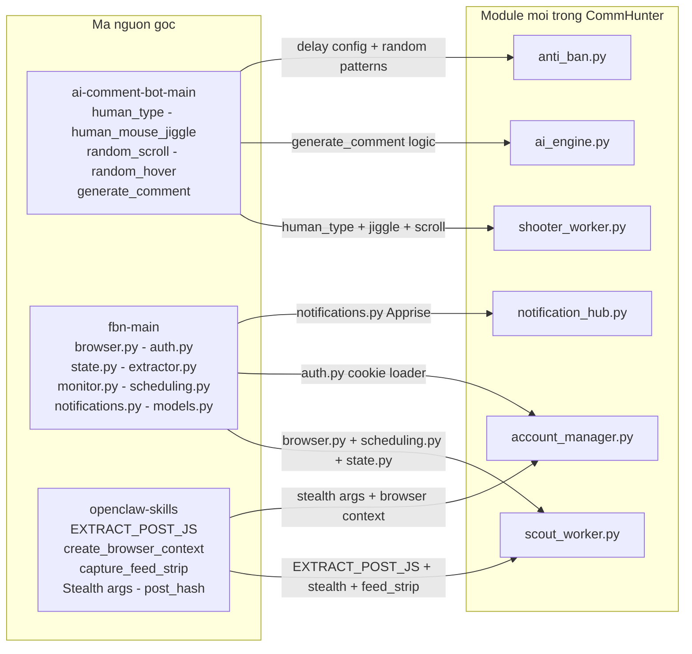
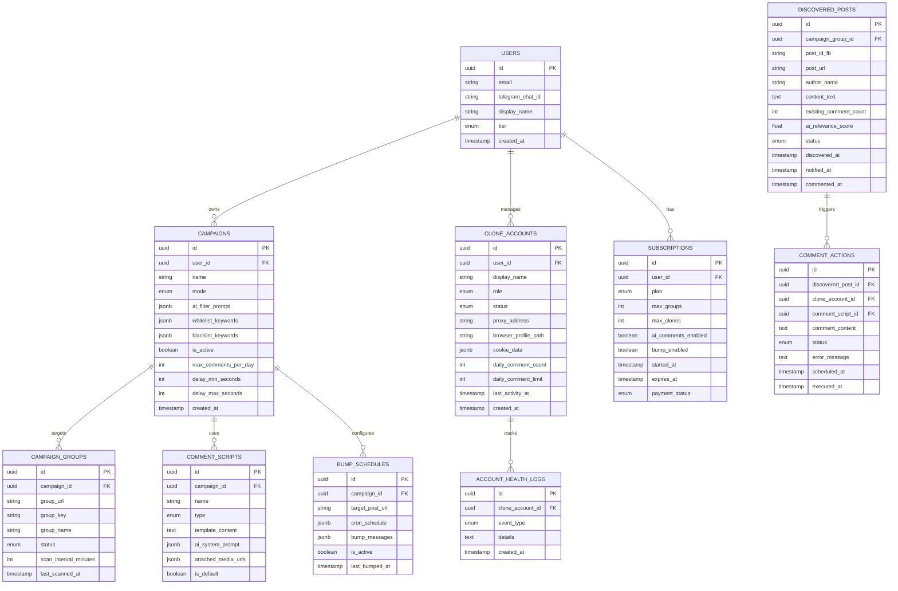
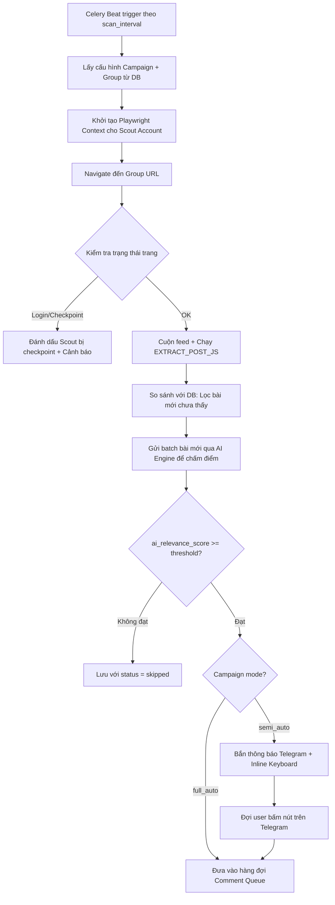
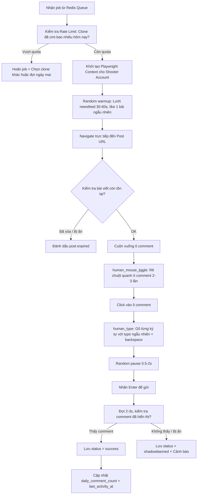
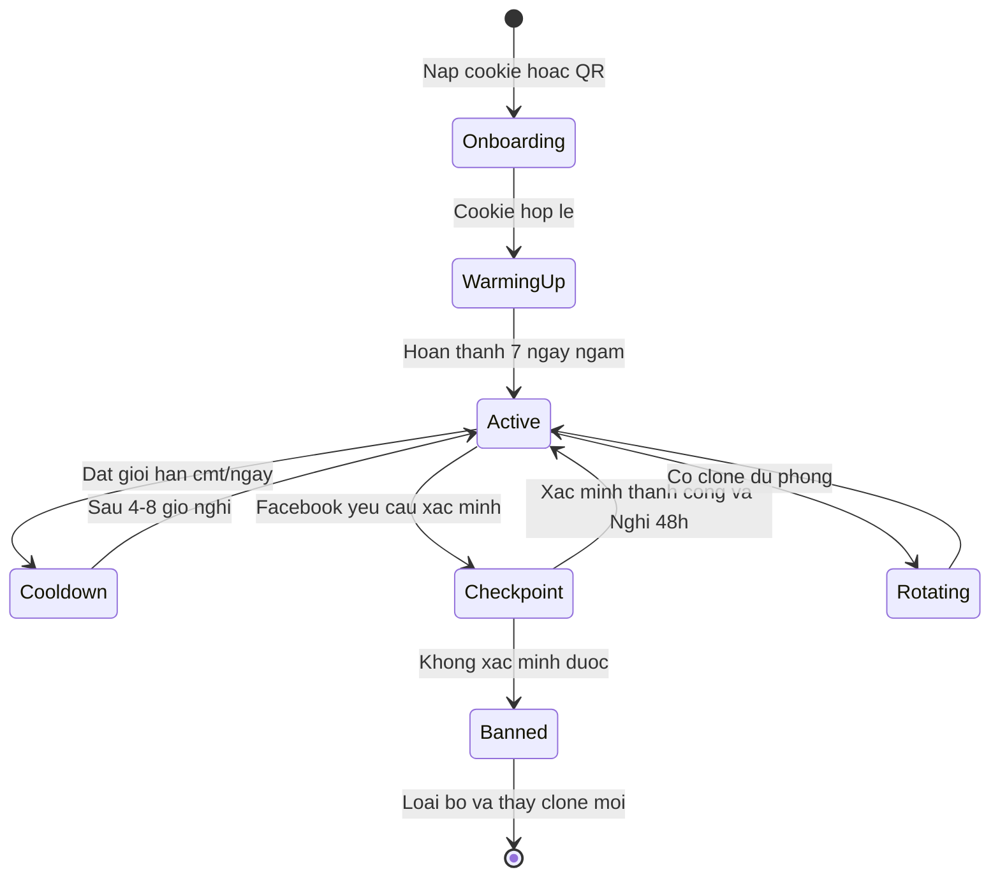
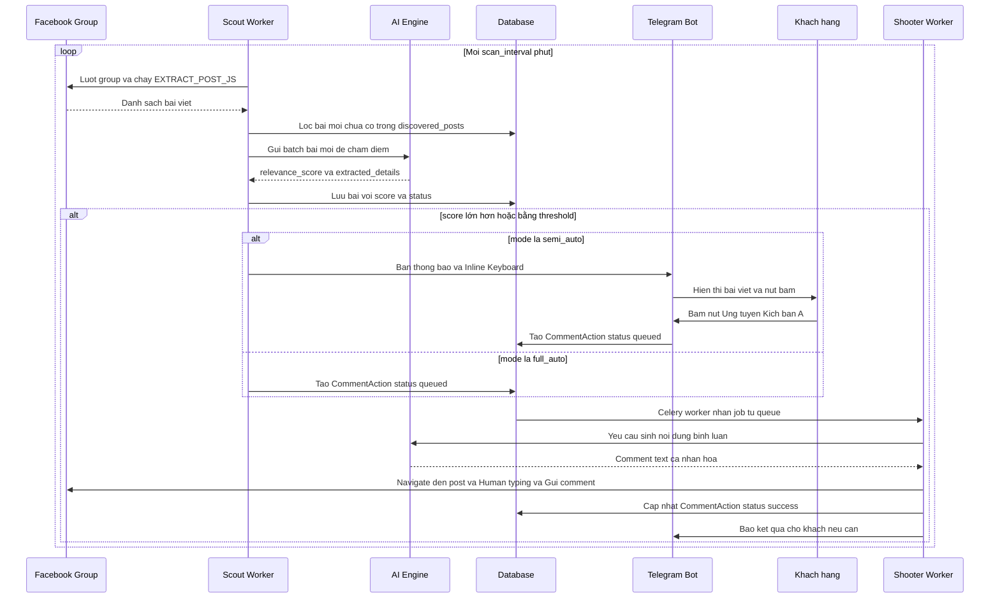
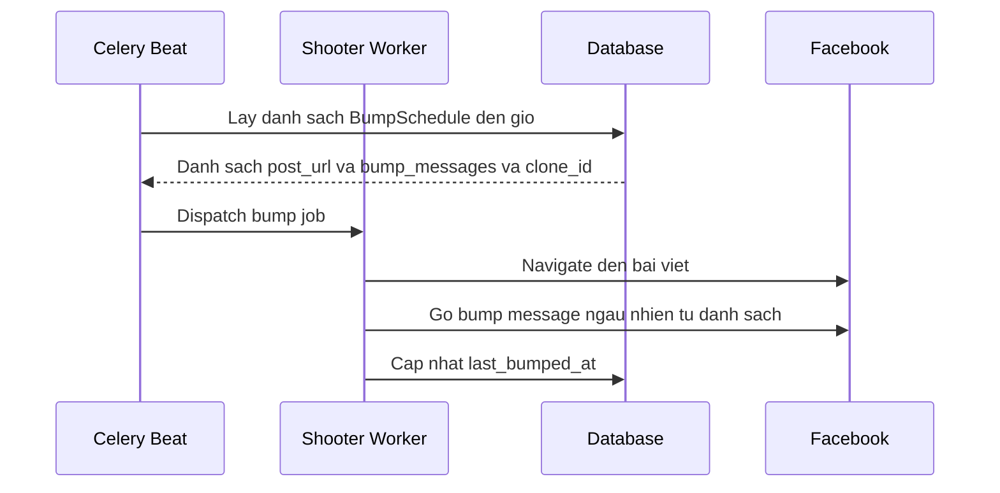
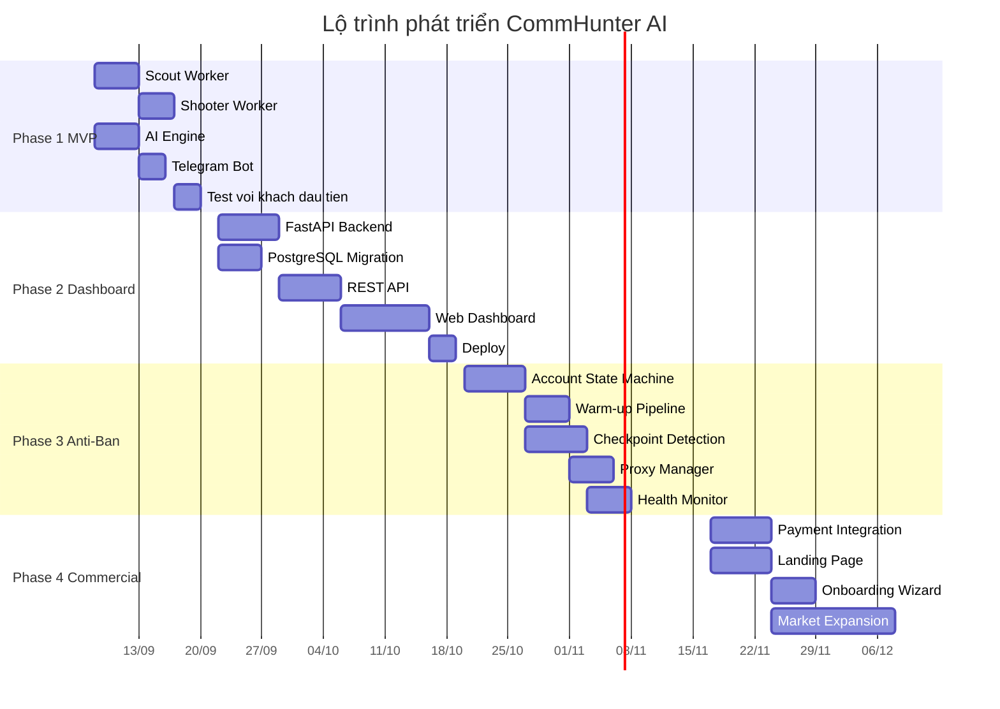

# MASTER PLAN — NỀN TẢNG COMMHUNTER AI (F-LEADS)

> **Tên dự án:** CommHunter AI / F-Leads
> **Tầm nhìn:** Nền tảng SaaS tự phục vụ giúp creator / shop dịch vụ tự động hóa 100% quy trình săn khách hàng tiềm năng, ứng tuyển và duy trì tương tác trong hội nhóm Facebook — an toàn, thông minh, 24/7.
> **Ngày khởi tạo:** 07/09/2026
> **Cập nhật lần cuối:** 08/09/2026
> **Trạng thái:** Phase 1 (MVP Script) — mã nguồn đã LẮP RÁP XONG và chạy được end-to-end với AI/Telegram giả lập. Chưa kiểm thử với Facebook thật. Xem [§0. Trạng thái triển khai](#0-trạng-thái-triển-khai).
> **Tài liệu tham chiếu:**
> - [01. Phân tích 3 hệ thống mã nguồn hiện có](file:///f:/Clone/fb-tool/docs/01_EXISTING_SYSTEMS_ANALYSIS.md)
> - [02. Đặc tả ý tưởng & kiến trúc nền tảng](file:///f:/Clone/fb-tool/docs/02_PLATFORM_SPECIFICATION_AND_IDEAS.md)

---

## MỤC LỤC

0. [**Trạng thái triển khai**](#0-trạng-thái-triển-khai) *đọc mục này trước*
1. [Tổng quan kiến trúc hệ thống](#1-tổng-quan-kiến-trúc-hệ-thống)
2. [Ma trận tái sử dụng mã nguồn](#2-ma-trận-tái-sử-dụng-mã-nguồn)
3. [Thiết kế Database Schema](#3-thiết-kế-database-schema)
4. [Chi tiết các Module kỹ thuật](#4-chi-tiết-các-module-kỹ-thuật)
5. [Luồng hoạt động chính (Core Workflows)](#5-luồng-hoạt-động-chính)
6. [Cơ chế an toàn & chống ban (Anti-Ban Engine)](#6-cơ-chế-an-toàn--chống-ban)
7. [Giao diện người dùng (Dashboard & Telegram Bot)](#7-giao-diện-người-dùng)
8. [Mô hình kinh doanh & Monetization](#8-mô-hình-kinh-doanh)
9. [Lộ trình phát triển 4 Phase](#9-lộ-trình-phát-triển-4-phase)
10. [Rủi ro & Biện pháp giảm thiểu](#10-rủi-ro--biện-pháp-giảm-thiểu)
11. [KPIs & Tiêu chí thành công](#11-kpis--tiêu-chí-thành-công)
12. [**Nợ kỹ thuật & Backlog Hardening**](#12-nợ-kỹ-thuật--backlog-hardening)

---

## 0. Trạng thái triển khai

> **Đây là nguồn sự thật về những gì ĐÃ chạy được.** Phần còn lại của tài liệu
> mô tả trạng thái **mục tiêu** — đừng nhầm hai thứ đó với nhau. Trước đây toàn
> bộ tài liệu viết ở thì tương lai nên rất khó biết dự án thực sự đang ở đâu.

*Cập nhật: 08/09/2026*

### 0.1 Bảng trạng thái Phase 1 (MVP Script)

| # | Thành phần | File | Trạng thái | Ghi chú |
|---|---|---|---|---|
| 1 | Data models | `commhunter/models.py` | Xong | 8 dataclass + 2 Enum |
| 2 | Config loader | `commhunter/config_loader.py` | Xong | YAML + resolve biến môi trường |
| 3 | Hằng số & ngưỡng | `commhunter/constants.py` | Xong | Gồm `EXTRACT_POST_JS` |
| 4 | Browser Manager | `commhunter/browser_manager.py` | Xong | Stealth shim tương thích v1/v2 |
| 5 | Scout Worker | `commhunter/scout_worker.py` | Xong | Chưa kiểm thử trên group thật |
| 6 | Dedup Store | `commhunter/dedup_store.py` | Xong | 3/9 bảng của schema đích |
| 7 | AI Engine | `commhunter/ai_engine.py` | Xong | Lọc + sinh comment, có retry |
| 8 | Human Emulator | `commhunter/human_emulator.py` | Xong | Safe hover + scroll bias + Shift+Enter giữ dòng (đã vá N-01, N-09) |
| 9 | Shooter Worker | `commhunter/shooter_worker.py` | Xong | Verify 2 tín hiệu (empty composer + text outside) + shadowban detection thật (đã vá N-02, N-03, N-04) |
| 10 | Telegram Bot | `commhunter/telegram_bot.py` | Xong | Inline Keyboard + Semi-Auto + singleton bot (đã vá N-07, N-08) |
| 11 | **Entry Point / Orchestrator** | `commhunter/commhunter.py` | Xong | CLI `run` / `login` / `status` |
| 12 | Dependencies & Package | `commhunter/requirements.txt` & `__init__.py` | Xong | Package hóa Python chuẩn (N-14) |
| 13 | Cấu hình & Pháp lý | `configs/example.yaml`, `nyatymita.yaml`, `NOTICE` | Xong | Đủ cấu hình mẫu + khách thực tế + bản quyền |
| 14 | `.gitignore` | `.gitignore` (gốc) | Xong | Chặn cookie & API key lọt lên git |
| 15 | Smoke test | `commhunter/tests/test_pipeline.py` | Xong | 104 assertion, 100% PASS offline |
| 16 | Kiểm thử với Facebook thật | — | **CHƯA LÀM** | Toàn bộ TC-01…TC-09 của Sprint 3 |
| 17 | Bàn giao khách đầu tiên | — | Chưa | Phụ thuộc mục 16 |

**Kết luận:** Phase 1 đã có **bộ khung chạy được**, nhưng chưa có **bằng chứng
hoạt động trên Facebook thật**. Ranh giới này là mấu chốt — mọi ước lượng cho
Phase 2/3 chỉ đáng tin sau khi Sprint 3 chạy xong.

### 0.2 Bắt đầu nhanh

```bash
cd commhunter
python -m venv .venv && .venv\Scriptsctivate     # Windows
pip install -r requirements.txt
playwright install chromium

# Đặt bí mật vào file .env ở thư mục gốc dự án (KHÔNG ghi thẳng vào YAML)
#   OPENAI_API_KEY=sk-...
#   TELEGRAM_BOT_TOKEN=123456789:AA...
#   TELEGRAM_CHAT_ID=987654321

cp configs/example.yaml configs/khach.yaml     # rồi sửa cho đúng khách

python commhunter.py status --config configs/khach.yaml   # kiểm tra trước
python commhunter.py login  --config configs/khach.yaml --profile scout
python commhunter.py login  --config configs/khach.yaml --profile shooter
python commhunter.py run    --config configs/khach.yaml

python tests/test_pipeline.py                  # smoke test, không cần mạng
```

Lệnh `status` là bước bắt buộc trước khi chạy thật: nó kiểm tra thư viện đã cài
đủ chưa, **stealth có thực sự kích hoạt không**, biến môi trường đã resolve
chưa, và session Facebook của scout/shooter còn sống không. Trả về exit code 1
nếu chưa sẵn sàng (dùng được trong script CI/cron).

### 0.3 Luồng đã lắp ráp thực tế



Hai quyết định thiết kế cần ghi nhớ:

1. **Lọc từ khóa đứng TRƯỚC AI.** Chi phí OpenAI tỉ lệ thuận với số bài lọt
   qua bước này. Trong smoke test, 2/5 bài bị chặn trước khi tốn 1 token nào.
2. **Hàng đợi Shooter chỉ có MỘT consumer.** Hai comment không bao giờ chạy
   song song trên cùng một tài khoản — đây là ràng buộc chống ban, không phải
   giới hạn kỹ thuật.

### 0.4 Khoảng cách giữa tài liệu và mã nguồn

| Tài liệu mô tả | Thực tế Phase 1 |
|---|---|
| PostgreSQL 9 bảng ([§3](#3-thiết-kế-database-schema)) | SQLite 3 bảng — đủ cho 1 khách, sẽ migrate ở Phase 2 |
| `scan_interval_minutes` riêng từng group | Lấy `min()` chung cho cả vòng lặp |
| Cột `ai_extracted` lưu trong DB | Giữ tạm trong RAM, mất khi restart |
| Anti-Ban 5 lớp ([§6](#6-cơ-chế-an-toàn--chống-ban)) | Mới có 3: rate limit, checkpoint detect, anti-crowding. Còn thiếu Profile Landing Page và Admin Blacklist |
| Shadowban Detection | Có hàm nhưng **cho kết quả sai** — xem N-02 |

---

## 1. Tổng quan kiến trúc hệ thống

### 1.1 Sơ đồ kiến trúc tổng thể



### 1.2 Nguyên tắc thiết kế cốt lõi

| # | Nguyên tắc | Mô tả |
|---|---|---|
| 1 | **Scout-Shooter Separation** | Tách biệt hoàn toàn tài khoản đọc bài (Scout) và tài khoản tương tác (Shooter). Scout chết không ảnh hưởng Shooter và ngược lại. |
| 2 | **Multi-tenant Isolation** | Mỗi khách hàng có dữ liệu, cấu hình, browser profile và proxy hoàn toàn cô lập. Một khách bị sự cố không ảnh hưởng khách khác. |
| 3 | **Human-in-the-loop First** | Mặc định chạy chế độ Semi-Auto (thông báo Telegram + nút duyệt). Full-Auto là tùy chọn nâng cao. |
| 4 | **Fail-safe & Graceful Degradation** | Khi phát hiện dấu hiệu checkpoint/ban, hệ thống tự dừng tài khoản đó, chuyển sang tài khoản dự phòng và bắn cảnh báo cho khách. |
| 5 | **AI-native Content** | Không dùng Spin-tax cổ điển. Mọi nội dung bình luận đều do LLM sinh ra theo ngữ cảnh bài viết cụ thể. |

---

## 2. Ma trận tái sử dụng mã nguồn

Kế hoạch kết hợp các module tốt nhất từ 3 repo hiện có thay vì viết lại từ đầu:



### Chi tiết tái sử dụng từng module

| Module nguồn | File gốc | Sẽ dùng cho | Cần chỉnh sửa |
|---|---|---|---|
| **Human Typing Engine** | [main.py](file:///f:/Clone/fb-tool/ai-comment-bot-main/main.py) L138-L180 | `shooter_worker.py` — Port từ Selenium sang Playwright `page.keyboard` API | Thay `element.send_keys()` bằng `page.keyboard.type()` / `page.keyboard.press()` với cùng random delay |
| **Mouse Jiggle** | [main.py](file:///f:/Clone/fb-tool/ai-comment-bot-main/main.py) L113-L136 | `shooter_worker.py` — Mô phỏng di chuột trước khi click vào ô comment | Thay `ActionChains` bằng `page.mouse.move()` |
| **Browser Context Manager** | [browser.py](file:///f:/Clone/fb-tool/fbn-main/fbn/browser.py) (41KB) | `account_manager.py` — Quản lý persistent context cho từng tài khoản clone | Thêm multi-profile support, proxy injection |
| **Cookie Auth Loader** | [auth.py](file:///f:/Clone/fb-tool/fbn-main/fbn/auth.py) | `account_manager.py` — Nạp session từ file cookie JSON/Netscape | Giữ nguyên, thêm API endpoint upload cookie |
| **State Store (SQLite)** | [state.py](file:///f:/Clone/fb-tool/fbn-main/fbn/state.py) (26KB) | `scout_worker.py` — Dedup bài viết, outbox notification | Migrate sang PostgreSQL cho multi-tenant |
| **Monitor Loop + Scheduler** | [scheduling.py](file:///f:/Clone/fb-tool/fbn-main/fbn/scheduling.py) | `scout_worker.py` — Vòng lặp quét group với backoff khi lỗi | Tích hợp vào Celery Beat thay vì threading |
| **URL Extractor** | [extractor.py](file:///f:/Clone/fb-tool/fbn-main/fbn/extractor.py) | `scout_worker.py` — Chuẩn hóa Group URL, Post URL, Post ID | Giữ nguyên |
| **DOM Post Extractor (JS)** | [fb-group-monitor.py](file:///f:/Clone/fb-tool/openclaw-skills-main/facebook-group-monitor/scripts/fb-group-monitor.py) L60-L184 | `scout_worker.py` — Bóc tách nội dung bài viết trực tiếp trên Facebook DOM | Bổ sung trích xuất comment count, reaction count |
| **Stealth Browser Config** | [fb-group-monitor.py](file:///f:/Clone/fb-tool/openclaw-skills-main/facebook-group-monitor/scripts/fb-group-monitor.py) L233-L254 | `account_manager.py` — Launch context với stealth plugin | Bổ sung fingerprint randomization |
| **Apprise Notification** | [notifications.py](file:///f:/Clone/fb-tool/fbn-main/fbn/notifications.py) | `notification_hub.py` — Bắn tin nhắn Telegram/Discord | Thêm Telegram Inline Keyboard cho Semi-Auto buttons |

---

## 3. Thiết kế Database Schema

### 3.1 Entity Relationship Diagram



### 3.2 Chi tiết các Enum Values

| Bảng | Field | Giá trị |
|---|---|---|
| `users` | `tier` | `starter`, `pro`, `studio` |
| `campaigns` | `mode` | `semi_auto`, `full_auto` |
| `campaign_groups` | `status` | `active`, `pending_join`, `blocked`, `paused` |
| `clone_accounts` | `role` | `scout`, `shooter`, `poster`, `both`, `all` |
| `clone_accounts` | `status` | `active`, `warming_up`, `cooldown`, `checkpoint`, `banned` |
| `comment_scripts` | `type` | `spintax`, `ai_contextual` |
| `discovered_posts` | `status` | `new`, `notified`, `commented`, `skipped`, `expired` |
| `comment_actions` | `status` | `queued`, `in_progress`, `success`, `failed`, `shadowbanned` |
| `mentions` | `status` | `new`, `read`, `archived` |
| `account_health_logs` | `event_type` | `login_ok`, `checkpoint`, `comment_blocked`, `rate_limited`, `banned`, `warmup_done` |
| `subscriptions` | `plan` | `starter`, `pro`, `studio` |
| `subscriptions` | `payment_status` | `active`, `expired`, `cancelled` |

---

## 4. Chi tiết các Module kỹ thuật

### 4.1 Scout Worker — Trinh sát quét bài

```
Nhiệm vụ: Lướt group Facebook, bóc tách bài viết mới, lưu vào DB và đánh giá bằng AI.
Tái sử dụng: fbn/browser.py + fbn/scheduling.py + openclaw/EXTRACT_POST_JS
```

**Luồng hoạt động:**


**Thông số kỹ thuật:**
- Quét tối đa 10-20 bài/lần/group (giới hạn bởi scroll depth)
- Giãn cách giữa các group: Random 30s - 90s
- Retry khi lỗi mạng: Exponential backoff (kế thừa `fbn/scheduling.py`)
- Dedup: So khớp `post_id_fb` + content hash (kế thừa `openclaw/post_hash()`)

---

### 4.2 Shooter Worker — Tay súng bình luận

```
Nhiệm vụ: Nhận job từ Comment Queue, mở trình duyệt Shooter, navigate đến bài viết,
           mô phỏng hành vi người thật và đăng bình luận.
Tái sử dụng: ai-comment-bot/human_type + human_mouse_jiggle (port sang Playwright)
```

**Luồng hoạt động:**


**Port Human Typing từ Selenium sang Playwright:**
```python
# Selenium gốc (ai-comment-bot):
# element.send_keys(char)
# time.sleep(random.uniform(0.08, 0.35))

# Playwright mới:
# await page.keyboard.type(char, delay=random.randint(80, 350))
# Với typo simulation:
# await page.keyboard.type(wrong_char, delay=random.randint(80, 350))
# await page.keyboard.press("Backspace")
```

---

### 4.3 AI Engine — Bộ não lọc & sinh nội dung

```
Nhiệm vụ: (1) Chấm điểm độ phù hợp của bài viết với tiêu chí khách hàng
           (2) Sinh nội dung bình luận cá nhân hóa theo ngữ cảnh bài đăng
```

**4.3.1 AI Filter (Chấm điểm bài viết)**
```
Input:  Nội dung bài viết + Prompt lọc của khách (tiếng Việt tự nhiên)
Output: { relevance_score: 0.0 - 1.0, reason: "...", extracted_details: {...} }
```

Ví dụ system prompt:
```
Bạn là trợ lý lọc bài viết trong group Facebook. Người dùng đang tìm khách hàng
có nhu cầu thuê viết truyện commission (fiction, fanfic, tiểu thuyết).

Tiêu chí khách hàng đặt ra:
"{user_ai_filter_prompt}"

Phân tích bài viết sau và trả về JSON:
- relevance_score: 0.0 (không liên quan) đến 1.0 (hoàn toàn phù hợp)
- reason: Giải thích ngắn gọn
- extracted: { genre, budget, deadline, couple, word_count } nếu có

Bài viết:
"{post_content}"
```

**4.3.2 AI Comment Generator (Sinh bình luận)**
```
Input:  Nội dung bài viết + Thông tin dịch vụ khách hàng + Extracted details từ AI Filter
Output: Một đoạn bình luận tự nhiên, không chứa link, 50-150 từ
```

Ví dụ prompt:
```
Viết một bình luận Facebook để ứng tuyển nhận viết commission dựa trên bài đăng bên dưới.

Thông tin dịch vụ của bạn:
- Tên: {service_name}
- Chuyên môn: {specialties}
- Điểm mạnh: {strengths}

Quy tắc:
1. KHÔNG dán link. Chỉ hướng dẫn xem portfolio ở đầu trang cá nhân.
2. Nhắc đến chi tiết cụ thể trong bài viết (thể loại, couple, bối cảnh...).
3. Giọng văn tự nhiên, thân thiện, không quá trang trọng.
4. Độ dài 50-150 từ tiếng Việt.

Bài viết khách đăng:
"{post_content}"
```

**Model lựa chọn & Chi phí ước tính:**

| Model | Dùng cho | Chi phí / 1000 bài |
|---|---|---|
| GPT-4o-mini | AI Filter + Comment Gen | ~15.000d (~$0.60) |
| Gemini 2.0 Flash | AI Filter (backup) | ~8.000d (~$0.30) |
| Claude Haiku 3.5 | Comment Gen (premium tier) | ~20.000d (~$0.80) |

---

### 4.4 Notification Hub — Trung tâm thông báo

```
Nhiệm vụ: Bắn thông báo tức thì về Telegram cho khách khi phát hiện bài viết tiềm năng.
           Cung cấp Inline Keyboard để khách duyệt/bỏ qua/chọn kịch bản 1 chạm.
Tái sử dụng: fbn/notifications.py (Apprise) + python-telegram-bot (Inline Keyboard)
```

**Mẫu thông báo Telegram (Semi-Auto mode):**
```
🎯 BÀI MỚI PHÙ HỢP!

📌 Nhóm: Hội Yêu Tiểu Thuyết
👤 Người đăng: Nguyễn Thảo
📝 Nội dung: "Mình đang tìm người viết fic ngôn tình hiện đại, couple
   công sở, khoảng 50k từ, budget 500k. Ai nhận viết inbox mình nhé..."

🤖 AI đánh giá: ⭐ 0.92/1.0 — Rất phù hợp (ngôn tình, budget rõ)

[🚀 Ứng tuyển Kịch bản A]  [📋 Kịch bản B (có demo)]
                    [❌ Bỏ qua]
                    [🔗 Mở bài viết]
```

---

### 4.5 Account Manager — Quản lý tài khoản Clone

```
Nhiệm vụ: Quản lý vòng đời tài khoản clone: Nạp cookie -> Ủ ấm -> Hoạt động -> Cooldown -> Thay thế.
           Quản lý Browser Profile Store và Proxy gán cố định.
Tái sử dụng: fbn/auth.py (Cookie Loader) + openclaw/create_browser_context (Stealth Config)
```

**State Machine của tài khoản Clone:**


**Pipeline "Ủ ấm" (Warm-up) tự động 7 ngày:**

| Ngày | Hành vi tự động | Mục đích |
|------|-----------------|----------|
| 1-2 | Lướt Newsfeed 5 phút, xem 2 Reels | Tạo footprint hoạt động |
| 3-4 | Like 3-5 bài ngẫu nhiên, xem thêm Reels | Tăng trust score |
| 5-6 | Comment 1-2 bài bạn bè (nội dung AI), join 2-3 group | Mở rộng social graph |
| 7 | Kiểm tra sức khỏe tổng thể, chuyển sang `Active` | Sẵn sàng hoạt động |

---

## 5. Luồng hoạt động chính

### 5.1 Luồng End-to-End: Từ bài viết mới đến chốt đơn



### 5.2 Luồng Auto-Bump



---

## 6. Cơ chế an toàn & chống ban

### 6.1 Bảng quy tắc Rate Limiting

| Thông số | Giá trị mặc định | Cho phép khách chỉnh | Ghi chú |
|---|---|---|---|
| **Comment/ngày/clone** | 20 | Có (tối đa 30) | Vượt quá thì Clone tự chuyển Cooldown |
| **Delay giữa 2 comment** | Random 5-15 phút | Có (tối thiểu 3 phút) | Không cho phép dưới 2 phút |
| **Tốc độ gõ phím** | 80-350ms/ký tự | Không | Hardcode trong Shooter |
| **Tỉ lệ typo giả** | 5% ký tự | Không | Tạo cảm giác gõ tay thật |
| **Warm-up trước comment** | 30-60s lướt feed | Không | Bắt buộc mỗi phiên |
| **Max group scan/giờ** | 10 groups | Có (theo gói) | Giãn cách 30-90s giữa các group |
| **Cooldown sau checkpoint** | 48 giờ | Không | Tự động dừng mọi hoạt động |

### 6.2 Phát hiện Checkpoint & Shadowban

```python
# Pseudocode: Checkpoint Detection
async def detect_checkpoint(page) -> str | None:
    url = page.url
    title = await page.title()

    if "checkpoint" in url or "login" in url:
        return "checkpoint_redirect"
    if any(kw in title.lower() for kw in ["security check", "xac minh", "confirm"]):
        return "security_check"

    # Shadowban detection: Kiem tra comment vua dang co hien thi khong
    # Mo tab an danh -> navigate den cung bai -> tim comment text
    # Neu khong thay -> shadowban
    return None
```

### 6.3 Chiến thuật Profile Landing Page

Thay vì dán link trong comment (dễ bị quét):
```
Sai:  "Mình nhận viết, xem tại https://facebook.com/NyatyWriting"
Đúng: "Mình chuyên thể loại này, portfolio và feedback mình ghim
          ở đầu trang cá nhân, bạn ghé xem thử nhé!"
```

Bot tự động **ghim bài giới thiệu dịch vụ** lên đầu tường nhà của mỗi Clone trước khi bắt đầu hoạt động.

### 6.4 Blacklist Admin/Mod

```python
# Khi Scout quét bài mới, kiểm tra:
if post.author_name in campaign.admin_blacklist:
    # Bỏ qua bài do Admin đăng -> tránh bị report
    mark_as_skipped(post, reason="admin_post")
```

### 6.5 Anti-Crowding (Không chen lấn)

```python
# Nếu bài đã có quá nhiều người ứng tuyển:
if post.existing_comment_count > campaign.max_competitor_comments:
    mark_as_skipped(post, reason="too_competitive")
```

---

## 7. Giao diện người dùng

### 7.1 Web Dashboard — Các màn hình chính

| # | Màn hình | Chức năng |
|---|---|---|
| 1 | **Dashboard Overview** | Tổng quan: Số bài đã quét hôm nay, số bài phù hợp, số comment đã bắn, tỷ lệ thành công. Biểu đồ xu hướng theo tuần. |
| 2 | **Quản lý Chiến dịch** | Tạo/sửa/xóa chiến dịch. Chọn chế độ Semi/Full-Auto. Nhập AI Filter prompt bằng tiếng Việt. |
| 3 | **Quản lý Group** | Thêm URL group, xem trạng thái (Active/Pending/Blocked). Đặt tần suất quét. |
| 4 | **Xưởng Kịch bản** | Soạn mẫu comment, xem preview AI-generated comment. Upload ảnh portfolio. |
| 5 | **Lịch Bump bài** | Cấu hình bài cần bump, khung giờ, nội dung bump. |
| 6 | **Quản lý Clone** | Danh sách tài khoản clone, trạng thái sức khỏe, số cmt hôm nay, nút nạp cookie. |
| 7 | **Feed bài viết** | Xem tất cả bài đã phát hiện, lọc theo trạng thái (new/commented/skipped), xem chi tiết từng bài. |
| 8 | **Báo cáo & Thống kê** | Biểu đồ hiệu suất: tỷ lệ phản hồi, thống kê theo group, theo thời gian. |

### 7.2 Telegram Bot — Tương tác nhanh

| Lệnh / Nút | Chức năng |
|---|---|
| `/start` | Liên kết tài khoản Web Dashboard |
| `/status` | Xem tóm tắt nhanh: bao nhiêu bài mới hôm nay, bao nhiêu cmt đã bắn |
| `/pause` / `/resume` | Tạm dừng / tiếp tục tất cả chiến dịch |
| `[Ung tuyen A]` | (Inline Keyboard) Duyệt comment bằng kịch bản A |
| `[Ung tuyen B]` | (Inline Keyboard) Duyệt comment bằng kịch bản B (có portfolio) |
| `[Bo qua]` | (Inline Keyboard) Bỏ qua bài viết này |
| `[Mo bai viet]` | (Inline Keyboard) Mở link bài viết trên Facebook |

---

## 8. Mô hình kinh doanh

### 8.1 Bảng giá gói cước

| Gói | Giá / tháng | Groups | Clones | AI Comment | Auto-Bump | Proxy | Hỗ trợ |
|---|---|---|---|---|---|---|---|
| **Starter** | 199.000d | 5 | 1 (tự cấp) | Chỉ Spintax | Không | Tự lo | Telegram group |
| **Pro** (Khuyên dùng) | 399.000d | 20 | 3 (tự cấp + hỗ trợ) | AI Contextual | Có | Shared | Telegram 1-1 |
| **Studio** | 799.000d | Không giới hạn | 10 (Platform cấp) | Premium AI | Có | Dedicated | Ưu tiên cao |

### 8.2 Nguồn doanh thu bổ sung

| Nguồn | Mô tả | Giá ước tính |
|---|---|---|
| **Bán clone chất lượng** | Clone đã ngâm trên 3 tháng, join sẵn group phổ biến | 50.000-100.000d/clone |
| **Proxy cho thuê** | 4G Mobile Proxy Việt Nam, IP sạch | 100.000-200.000d/tháng/IP |
| **Gói AI nâng cao** | Sử dụng Claude Opus hoặc GPT-4o cho comment premium | +100.000d/tháng |
| **Setup trọn gói** | Cài đặt, cấu hình chiến dịch, training cho khách mới | 500.000d/lần |

### 8.3 Ước tính chi phí vận hành & lợi nhuận

| Hạng mục | Chi phí / tháng / 100 khách |
|---|---|
| VPS (4 vCPU, 16GB RAM) | ~800.000d ($30) |
| PostgreSQL Managed | ~400.000d ($15) |
| Redis Managed | ~250.000d ($10) |
| LLM API (GPT-4o-mini) | ~1.500.000d ($60) — ước tính 100k request |
| Proxy Pool (50 IP) | ~5.000.000d ($200) |
| **Tổng chi phí** | **~8.000.000d** |
| **Doanh thu (100 khách x 399k trung bình)** | **~39.900.000d** |
| **Lợi nhuận gộp** | **~31.900.000d (~80%)** |

---

## 9. Lộ trình phát triển 4 Phase

### Phase 1: MVP Script — Tuần 1-2 (Quick Win)

> **Mục tiêu:** Bàn giao công cụ chạy được cho khách Nyatymita trong 2 tuần, bắt đầu thu phí.
> **Trạng thái:** Sprint 1 & 2 xong. Sprint 3 (kiểm thử thật + bàn giao) chưa bắt đầu.

**Sprint 1-2 — Xây dựng (ĐÃ XONG):**

- [x] Viết `scout_worker.py`: Playwright stealth context (`openclaw`) + DOM extractor (`EXTRACT_POST_JS`) + SQLite dedup (`fbn/state.py`)
- [x] Viết `shooter_worker.py`: Port `human_type` + `human_mouse_jiggle` từ Selenium sang Playwright
- [x] Viết `ai_engine.py`: Tích hợp OpenAI GPT-4o-mini cho AI Filter + Comment Generator
- [x] Viết `telegram_bot.py`: Bắn thông báo + Inline Keyboard (Semi-Auto)
- [x] Viết `configs/example.yaml`: File cấu hình mẫu, bí mật đọc từ biến môi trường
- [x] Viết `commhunter.py`: Entry point CLI + Orchestrator (`run` / `login` / `status`), graceful shutdown
- [x] Viết `requirements.txt` + `.gitignore` (chặn cookie Facebook lọt lên git)
- [x] Smoke test offline `tests/test_pipeline.py` — 36 assertion, không cần Playwright/OpenAI/Telegram

**Sprint 3 — Kiểm thử & Bàn giao (Sẵn sàng kiểm thử Facebook thật):**

- [x] **Sprint 0 Hardening:** đã xử lý triệt để 4 lỗi nặng (N-01 đến N-04), bộ test pipeline đạt 66/66 PASS offline.
- [x] **Hardening đợt 2 (N-05 đến N-08):** đã xử lý triệt để 4 lỗi vừa (dynamic service_info, regex post_id, singleton telegram bot, validate chat_id), bộ test pipeline đạt 84/84 PASS offline.
- [x] **Hardening đợt 3 (N-09 đến N-14) & Pháp lý:** xử lý triệt để 6 nợ kỹ thuật nhẹ (Shift+Enter bảo tồn xuống dòng, get_running_loop, SQL whitelist, hằng số delay, package `__init__.py`), bổ sung file `NOTICE`, bộ test pipeline đạt 104/104 PASS offline.
- [x] Cấu hình `configs/nyatymita.yaml` với group thực tế cho khách đầu tiên.
- [ ] TC-01 → TC-09: chạy đủ 9 test case tích hợp trên group Facebook thật
- [ ] Chạy thử 24h trên VPS, giám sát log
- [ ] Hướng dẫn khách dùng Telegram Bot + thiết lập thanh toán tháng đầu
- [ ] **Deliverable:** Script CLI chạy `python commhunter.py run --config configs/nyatymita.yaml`

---

### Phase 2: Web Dashboard — Tuần 3-6

> **Mục tiêu:** Xây dựng giao diện Self-Service để khách tự cấu hình, không cần can thiệp kỹ thuật.

- [ ] Setup FastAPI Backend + PostgreSQL + Redis + Celery
- [ ] Migrate schema từ SQLite sang PostgreSQL (multi-tenant)
- [ ] Xây dựng REST API: Auth, Campaign CRUD, Group CRUD, Script CRUD, Clone Management
- [ ] Xây dựng Web Dashboard: Next.js + Shadcn UI
- [ ] Tích hợp Telegram Bot Webhook với Backend
- [ ] Deploy lên VPS/Cloud (Docker Compose)
- [ ] **Deliverable:** `https://app.commhunter.vn` — Khách đăng ký, tự cấu hình và bắt đầu sử dụng

---

### Phase 3: Anti-Ban Engine & Account Manager — Tuần 7-10

> **Mục tiêu:** Hardening hệ thống để chạy bền bỉ, tự động phát hiện và xử lý sự cố tài khoản.

- [ ] Xây dựng Account State Machine (Onboarding -> WarmUp -> Active -> Cooldown -> Checkpoint -> Banned)
- [ ] Tự động Warm-up Pipeline 7 ngày cho clone mới
- [ ] Checkpoint Detection & Auto-pause
- [ ] Shadowban Detection (kiểm tra comment có hiển thị không)
- [ ] Proxy Manager: Gán cố định IP cho mỗi clone, auto-rotate khi IP bị đánh dấu
- [ ] Rate Limiter thông minh: Adaptive delay dựa trên feedback từ Facebook
- [ ] Dashboard: Bảng Health Monitor cho tất cả clone
- [ ] **Deliverable:** Hệ thống tự vận hành 24/7, tự phục hồi khi gặp sự cố

---

### Phase 4: Thương mại hóa & Mở rộng — Tuần 11+

> **Mục tiêu:** Đóng gói SaaS hoàn chỉnh, mở bán rộng rãi.

- [ ] Tích hợp cổng thanh toán (VNPay / Momo / Stripe)
- [ ] Trang Landing Page marketing + SEO
- [ ] Onboarding wizard cho khách mới (guided setup)
- [ ] Hệ thống Referral / Affiliate
- [ ] Mở rộng thị trường: Vẽ Commission, Dịch thuật, Content Marketing, Gia sư, Freelancer...
- [ ] Admin Dashboard: Quản lý tất cả tenant, billing, usage analytics
- [ ] **Deliverable:** Sản phẩm SaaS production-ready, có khách trả phí ổn định

---

### Tổng quan Timeline



---

## 10. Rủi ro & Biện pháp giảm thiểu

| # | Rủi ro | Mức độ | Biện pháp giảm thiểu |
|---|---|---|---|
| 1 | **Facebook thay đổi DOM structure** khiến EXTRACT_POST_JS hỏng | Trung bình | Monitoring tự động: Nếu Scout trả về 0 bài 3 lần liên tiếp thì cảnh báo dev. Duy trì test suite cho JS extractor. |
| 2 | **Facebook tăng cường phát hiện bot** | Cao | Đa tầng phòng thủ: Stealth plugin + Fingerprint rotation + Human emulation. Luôn cập nhật theo cộng đồng Playwright stealth. |
| 3 | **Clone bị ban hàng loạt** | Trung bình | Không bao giờ chạy nhiều clone trên cùng 1 IP. Mỗi clone có proxy riêng. Dàn clone dự phòng sẵn sàng thay thế. |
| 4 | **Khách hàng bị Admin group ban** | Trung bình | Blacklist Admin, Anti-crowding, content chất lượng cao (AI) thay vì spam copy-paste. |
| 5 | **Chi phí LLM API tăng** | Thấp | Sử dụng model rẻ nhất (GPT-4o-mini / Gemini Flash). Cache kết quả AI Filter cho các bài tương tự. |
| 6 | **Vấn đề pháp lý & vi phạm ToS Facebook** | **Cao** | Đánh giá lại từ "Trung bình". Công cụ vi phạm trực tiếp Điều khoản Facebook (nick clone, tự động đăng nội dung thương mại). Ở mô hình SaaS thu phí định kỳ, disclaimer **không** chuyển hết trách nhiệm sang khách. Cần: tư vấn pháp lý trước Phase 4; ToS ghi rõ khách sở hữu và chịu trách nhiệm về tài khoản; không thu thập/bán dữ liệu cá nhân bên thứ 3; chuẩn bị kịch bản khi toàn bộ dàn nick bị Meta khoá. |
| 7 | **Cạnh tranh từ tool tương tự** | Trung bình | Differentiator: AI contextual comment (không phải spam), Semi-Auto UX trên Telegram, Anti-ban nhiều lớp. |
| 8 | **Bản quyền mã nguồn tái sử dụng** | **Cao** | `ai-comment-bot-main` **KHÔNG có file LICENSE** → mặc định "all rights reserved", trong khi [§2](#2-ma-trận-tái-sử-dụng-mã-nguồn) chỉ định port code từ đó vào sản phẩm thương mại. Phải: liên hệ tác giả xin phép, hoặc **viết lại** `human_type`/`post_comment` từ đặc tả thay vì port nguyên. `fbn-main` (MIT © viseshrp) và `openclaw-skills-main` (MIT © phuc-nt) hợp lệ nhưng **bắt buộc** giữ thông báo bản quyền — tạo file `NOTICE` trước khi phát hành. |
| 9 | **Rò rỉ session cookie của khách** | **Cao** | `commhunter/data/browser_profiles/` chứa cookie đăng nhập Facebook của khách. Commit nhầm lên git = mất tài khoản khách + trách nhiệm pháp lý. Đã có `.gitignore` chặn ở thư mục gốc — **không bao giờ được gỡ dòng đó**. Ở Phase 2 (multi-tenant) phải mã hoá at-rest và tách quyền truy cập theo tenant. |
| 10 | **Thư viện stealth đổi API** | Trung bình | `playwright-stealth` 2.0 đã bỏ `stealth_async`, khiến code cũ âm thầm chạy KHÔNG stealth mà vẫn tưởng bình thường — nguy hiểm hơn crash. Đã xử lý bằng shim tương thích v1/v2 trong `browser_manager.apply_stealth()` và cảnh báo rõ ở lệnh `status`. Quy tắc chung: **mọi lớp phòng thủ im lặng thất bại đều phải có kiểm tra chủ động**. |

---

## 11. KPIs & Tiêu chí thành công

### Phase 1 (MVP)
- [ ] Khách Nyatymita có ít nhất **3 khách mới / tuần** từ tool (so với 0 khách/tuần khi CTV lười)
- [ ] Không có clone nào bị checkpoint trong 7 ngày đầu chạy thử
- [ ] Thời gian phản hồi (từ lúc bài đăng xuất hiện đến khi bot phát hiện): **dưới 5 phút**

### Phase 2 (Dashboard)
- [ ] **10 khách trả phí** trong tháng đầu ra mắt
- [ ] Tỷ lệ khách tự cấu hình thành công mà không cần hỗ trợ: **trên 70%**
- [ ] Uptime hệ thống: **trên 99%**

### Phase 3 (Anti-Ban)
- [ ] Tỷ lệ clone sống trên 30 ngày: **trên 90%**
- [ ] Tỷ lệ comment thành công (không bị shadowban): **trên 95%**
- [ ] Thời gian tự phục hồi khi clone bị checkpoint: **dưới 1 phút** (auto-switch sang clone dự phòng)

### Phase 4 (Commercialization)
- [ ] **50+ khách trả phí** ổn định
- [ ] MRR (Monthly Recurring Revenue): **trên 15.000.000d / tháng**
- [ ] Churn rate: **dưới 10% / tháng**

---

## 12. Nợ kỹ thuật & Backlog Hardening

> Kết quả rà soát mã nguồn ngày 08/09/2026. **Mức nặng phải xử lý xong TRƯỚC khi
> chạy trên Facebook thật** — đây đều là lỗi khiến hệ thống "chạy mà sai", nguy
> hiểm hơn crash vì không ai biết để sửa.

### 12.1 Đã xử lý

| Mã | Vấn đề | File | Cách xử lý |
|---|---|---|---|
| H-01 | `playwright-stealth` 2.x bỏ `stealth_async` → `ImportError` bị nuốt, browser chạy TRẦN mà log báo "chưa cài đặt" | `browser_manager.py` | Thêm `apply_stealth()` tương thích v1/v2 + `stealth_status()`. Lệnh `status` báo rõ stealth có kích hoạt không |
| H-02 | `check_session()` đóng context nhưng để lại entry chết trong `self._contexts` → `get_stealth_page()` trả page trên context đã đóng | `browser_manager.py` | Dọn dẹp trong khối `finally`, gỡ khỏi dict |
| H-03 | `send_result_notification()` dùng `parse_mode="Markdown"` với text CHƯA escape → Telegram trả 400, mất hẳn thông báo kết quả | `telegram_bot.py` | Chuyển MarkdownV2 + `_escape_md` + fallback plain-text |
| H-04 | `_escape_md` không escape `\` trước → hỏng chuỗi khi nội dung chứa backslash | `telegram_bot.py` | Escape backslash đầu tiên |
| H-05 | Không có cách dừng Telegram polling → Ctrl+C để lại tiến trình treo | `telegram_bot.py` | Thêm `stop_polling()`, gọi trong `CommHunterApp.shutdown()` |
| H-06 | Biến môi trường chưa đặt vẫn lọt tới runtime thành lỗi 401 khó hiểu; `_validate_config` chỉ log warning | `commhunter.py` | `find_config_problems()` chặn ngay lúc khởi động, `run` từ chối chạy, `status` trả exit code 1 |
| H-07 | So khớp từ khóa phân biệt dấu → bỏ sót phần lớn bài viết vì người Việt hay gõ không dấu ("can viet gap") | `commhunter.py` | `normalize_vi()` bỏ dấu + hạ chữ thường trước khi so khớp |
| H-08 | Không có cách tra ngược bài viết từ `content_hash` (cần cho callback Telegram) | `dedup_store.py` | Thêm `get_post_by_hash()` + `row_to_post()` |
| N-01 | Warmup click link ngẫu nhiên trên Facebook (`random_browse`) có nguy cơ click rời nhóm, report, logout | `human_emulator.py`, `constants.py` | Bỏ hẳn click/go_back, thay bằng `safe_hover()` chỉ duyệt `[role="feed"] a[href]` qua blocklist URL và label, thêm bias cuộn xuống 80% (`WARMUP_SCROLL_DOWN_BIAS`) |
| N-02 | Verify comment tìm trong `body` cho dương tính giả khi Enter không gửi được (text còn trong composer) | `shooter_worker.py` | Kiểm tra 2 tín hiệu: `_composer_is_empty` (bắt buộc trống) và `_text_present_outside` (TreeWalker duyệt body loại trừ composer) |
| N-03 | `_verify_comment` bắt exception rồi return `SUCCESS` làm sai lệch kết quả | `shooter_worker.py` | Đổi nhánh exception thành `CommentStatus.FAILED`, phát hiện chính xác `SHADOWBANNED` nếu composer trống nhưng text không ra ngoài |
| N-04 | Rate limit chỉ đếm comment thành công; gọi trực tiếp post_comment mất bản ghi | `dedup_store.py`, `shooter_worker.py`, `commhunter.py` | Đổi quota sang đếm LƯỢT (`get_today_action_count`). Thêm `record_attempt`/`finish_attempt` theo dõi mọi lần thử. Thêm Circuit Breaker tự ngắt sau 3 lỗi liên tiếp |
| N-05 | Fallback comment hardcode ngành nghề ("viết truyện chữ") nằm trong code lõi | `ai_engine.py` | Bỏ hardcode novel, dynamic prompt lấy theo `service_info.get("name")`. Lỗi API trả `""` để orchestrator bỏ qua bài an toàn thay vì comment nhầm nội dung |
| N-06 | `post_id` parse bằng `split("/")[-2]` lỗi khi URL không có `/` cuối hoặc dạng query parameter | `scout_worker.py` | Thêm pure function `extract_post_id()` hỗ trợ regex cho `/(?:posts\|permalink)/(\d+)`, `story_fbid`, `fbid`, và trailing numeric ID |
| N-07 | Tạo `Bot()` mới mỗi lần gửi tin, không `shutdown()` gây rò rỉ session | `telegram_bot.py`, `commhunter.py` | Áp dụng Singleton `_get_bot()`, tái sử dụng trong toàn bộ class, bổ sung `close()` gọi `await self._bot.shutdown()` khi dừng ứng dụng |
| N-08 | Callback Inline Keyboard không kiểm tra `chat_id` và thiếu try/except split | `telegram_bot.py` | Thêm kiểm tra `effective_chat.id == config.chat_id` (cảnh báo + alert nếu sai), bọc `data.split(":", 1)` bằng try/except ValueError tránh crash |
| N-09 | `human_type` mất định dạng xuống dòng khi gõ comment AI | `human_emulator.py` | Tách dòng theo `\n`, dùng tổ hợp phím `Shift+Enter` để xuống dòng chuẩn xác trong ô soạn thảo Facebook mà không làm gửi bài sớm |
| N-10 | `_increment_daily_stat` nội suy cột f-string chưa kiểm soát | `dedup_store.py` | Bổ sung whitelist `ALLOWED_STAT_COLUMNS`, từ chối và raise `ValueError` nếu tên cột không nằm trong whitelist |
| N-11 | `asyncio.get_event_loop()` đã deprecated (Python 3.10+) | `ai_engine.py`, `human_emulator.py`, `browser_manager.py` | Chuyển đổi toàn bộ sang `asyncio.get_running_loop()`, sạch 100% cảnh báo |
| N-12 | Hằng số giãn cách và ngưỡng an toàn chưa đồng bộ | `constants.py`, `scout_worker.py`, `models.py` | Dùng `SCAN_DELAY_MIN_SEC`/`SCAN_DELAY_MAX_SEC` thay cho hardcode; đồng bộ `DEFAULT_DB_PATH` và `MAX_COMMENTS_PER_DAY` |
| N-13 | Ràng buộc đồng bộ đơn luồng của SQLite chưa được ghi chú | `dedup_store.py` | Bổ sung docstring kiến trúc cảnh báo rõ ràng về ràng buộc single-thread event loop và định hướng connection pool cho Phase 2 |
| N-14 | Thiếu `__init__.py` đóng gói package | `commhunter/__init__.py` | Tạo file `__init__.py` chuẩn hóa package và export đầy đủ models, stores, loaders |

### 12.2 Còn tồn — chuẩn bị cho Phase 2

**Tất cả các nợ kỹ thuật từ N-01 đến N-14 đã được xử lý triệt để 100%!** Mã nguồn hiện tại không còn bất kỳ nợ kỹ thuật hay cảnh báo deprecation nào.

### 12.3 Thứ tự đề xuất

1. **Sprint 0 Hardening:** ĐÃ HOÀN THÀNH — xử lý triệt để N-01 → N-04, 66/66 test assertion pass offline.
2. **Backlog Hardening đợt 2:** ĐÃ HOÀN THÀNH — xử lý triệt để N-05 → N-08, nâng test suite lên 84/84 PASS offline.
3. **Hardening đợt 3 & Pháp lý:** ĐÃ HOÀN THÀNH — xử lý triệt để N-09 → N-14, tạo file `NOTICE` bản quyền tác giả và file cấu hình `configs/nyatymita.yaml`, nâng test suite lên **104/104 PASS offline**.
4. **Sprint 3 (Thực địa):** Chạy đủ TC-01 → TC-09 trên Facebook thật với tài khoản và group của khách Nyatymita.
5. **Phase 2:** Khởi động xây dựng Web Dashboard (FastAPI Backend + Next.js + PostgreSQL + Celery) theo `docs/plans/phase2_dashboard_detail.md`.

### 12.4 Nguyên tắc rút ra

> Tỷ lệ tài liệu / mã nguồn của dự án này từng là 3.050 / 2.091 dòng, trong khi
> mã nguồn **không chạy được** vì thiếu entry point. Bốn phase kế hoạch đã được
> viết xong trước khi Phase 1 chạy lần đầu.
>
> **Quy tắc từ nay:** không viết kế hoạch chi tiết cho Phase N+1 khi Phase N
> chưa chạy end-to-end được một lần trên môi trường thật. Phản hồi từ lần chạy
> thật sẽ làm thay đổi đáng kể các giả định phía sau.

---

> [!IMPORTANT]
> **Bước tiếp theo ngay lập tức:** Chạy `python commhunter.py status --config configs/khach.yaml`
> để xác nhận môi trường, sau đó xử lý **Sprint 0 Hardening** (N-01 → N-04 ở
> [§12.2](#122-còn-tồn--phải-xử-lý-trước-khi-chạy-thật)) rồi mới bước vào Sprint 3
> kiểm thử với Facebook thật. Chạy thật trước khi vá N-01/N-02 là tự phá tài
> khoản của khách và tự tạo số liệu thành công giả.
