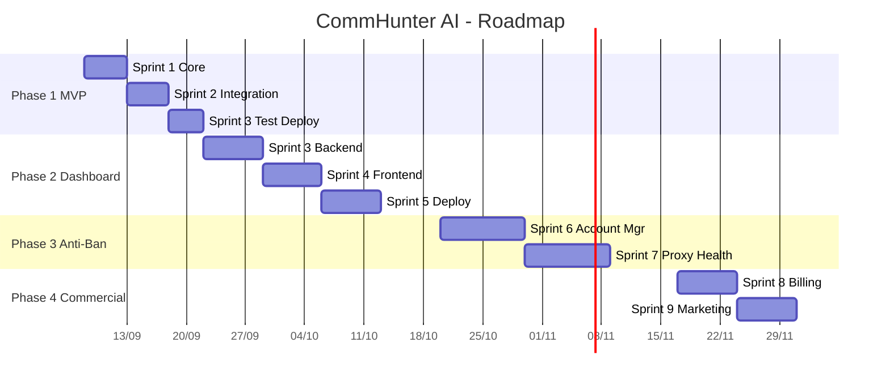

# DANH MỤC CÁC KẾ HOẠCH TRIỂN KHAI CHI TIẾT

> Mỗi Phase trong [Master Plan](file:///f:/Clone/fb-tool/docs/03_MASTER_PLAN.md) được tách thành 1 tài liệu triển khai chi tiết riêng, bao gồm: Task breakdown theo ngày, code reference chính xác đến dòng, pseudocode, acceptance criteria và test cases.

> **Xem trước khi đọc plan:** [TÌNH TRẠNG BÀN GIAO](file:///f:/Clone/fb-tool/docs/plans/DELIVERY_STATUS.md) — đối chiếu từng task trong plan với mã nguồn đã thực sự tồn tại, kèm bằng chứng test và danh sách việc còn bị chặn bởi yếu tố ngoài (tài khoản Facebook thật, VPS, cổng thanh toán).

---

## Tổng quan 4 Phase

---

## Danh sách Plans

### [Phase 1 — MVP Script (Tuần 1-2)](file:///f:/Clone/fb-tool/docs/plans/phase1_mvp_detail.md)

| Sprint | Nội dung | Tasks |
|--------|----------|-------|
| **Sprint 1** (Ngày 1-5) | Nền tảng Core | 5 tasks: Config YAML + Data Models, Browser Manager (Playwright Stealth), Scout Worker (Quét bài), Dedup Store (SQLite), AI Engine (Filter + Comment Gen) |
| **Sprint 2** (Ngày 6-10) | Tương tác & Kết nối | 4 tasks: Human Emulator (Port typing sang Playwright), Shooter Worker (Comment), Telegram Bot (Semi-Auto Inline Keyboard), CLI Entry Point |
| **Sprint 3** (Ngày 11-14) | Test & Bàn giao | 2 tasks: Integration Test (9 test cases), Setup cho khách Nyatymita |

**Deliverable:** `python commhunter.py --config nyatymita.yaml`

---

### [Phase 2 — Web Dashboard & Backend (Tuần 3-6)](file:///f:/Clone/fb-tool/docs/plans/phase2_dashboard_detail.md)

| Sprint | Nội dung | Tasks |
|--------|----------|-------|
| **Sprint 3** (Tuần 3) | Backend Foundation | 5 tasks: Docker Compose stack, PostgreSQL Migration (9 bảng), Auth API (JWT), Campaign CRUD API, Clone Management API |
| **Sprint 4** (Tuần 4) | Frontend Dashboard | 9 tasks: Next.js Setup, Dashboard Overview, Campaign Manager, Group Manager, Script Studio, Clone Manager, Post Feed, Bump Scheduler, Stats & Reports |
| **Sprint 5** (Tuần 5-6) | Tích hợp & Deploy | 3 tasks: Telegram Webhook, E2E Testing (6 test cases), Production Deploy (VPS + Docker + SSL) |

**Deliverable:** `https://app.commhunter.vn`

---

### [Phase 3 — Anti-Ban Engine & Account Manager (Tuần 7-10)](file:///f:/Clone/fb-tool/docs/plans/phase3_antiban_detail.md)

| Sprint | Nội dung | Tasks |
|--------|----------|-------|
| **Sprint 6** (Tuần 7-8) | Account Lifecycle | 3 tasks: Account State Machine (7 states, transitions, auto-switch), Warm-up Pipeline (7-day schedule), Checkpoint Detection (3-layer) + Shadowban Detection |
| **Sprint 7** (Tuần 9-10) | Proxy & Monitoring | 3 tasks: Proxy Manager (pool, assign, rotate, health check), Adaptive Rate Limiter (dynamic delay), Health Monitor Dashboard (real-time) |

**Deliverable:** Hệ thống tự vận hành 24/7, tự phục hồi

---

### [Phase 4 — Thương mại hóa & Mở rộng (Tuần 11+)](file:///f:/Clone/fb-tool/docs/plans/phase4_commercial_detail.md)

| Sprint | Nội dung | Tasks |
|--------|----------|-------|
| **Sprint 8** (Tuần 11-12) | Thanh toán | 3 tasks: Billing Service (quota, expiry), Payment Gateway (VNPay/Momo), Onboarding Wizard (5-step guided setup) |
| **Sprint 9** (Tuần 13-14) | Marketing | 4 tasks: Landing Page (SEO-optimized), Referral/Affiliate system, Admin Dashboard, Industry Templates (vẽ comm, dịch thuật, content...) |

**Deliverable:** SaaS production-ready, 50+ khách trả phí

---

## Tổng hợp số liệu

| Metric | Giá trị |
|--------|---------|
| **Tổng số Tasks** | 38 tasks |
| **Tổng số Sprints** | 9 sprints |
| **Tổng thời gian ước tính** | 14 tuần (~3.5 tháng) |
| **Files mã nguồn mới ước tính** | ~50 files |
| **API Endpoints** | ~35 endpoints |
| **Database Tables** | 11 bảng (9 chính + 2 bổ sung Phase 3-4) |
| **Frontend Pages** | 12 trang |
| **Test Cases** | 15+ test cases |

### Đã hiện thực được bao nhiêu (thực đo, 08/09/2026)

| Metric | Kế hoạch | Thực tế |
|--------|----------|---------|
| API Endpoints | ~35 | **62 operation / 48 đường dẫn** |
| Database Tables | 11 | **11** (migration `0001` lên/xuống sạch) |
| Frontend Pages | 12 | **12 route**, build TypeScript 0 lỗi |
| Test assertion | 15+ case | **236 assertion** (104 Phase 1 + 132 backend), toàn bộ offline |
| Docker services | 5 | **5** (+1 dashboard tùy chọn qua profile) |
